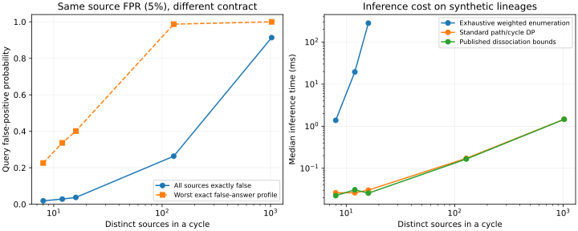

# Reproducible synthetic results

175 method/case comparisons; 0 asserted bounds failed reference coverage at tolerance 1e-12. Occurrence-product point estimates disagreed in 23 cases.

Times are median milliseconds from three runs unless benchmark metadata says otherwise. Memory is peak traced allocation during inference, excluding input construction. These are Python synthetic lineage comparisons, not compressed-filter or database throughput. Large cycle reference values use the same standard DP being timed; independent exhaustive comparison is restricted to small cases. Dissociation is the symmetric published baseline, not optimized scaled dissociation.

| Case | Method | Acceptance interval | ms | Peak bytes |
|---|---|---|---:|---:|
| repeated_and_false | occurrence_product | [3.9062531e-11, 3.9062531e-11] | 0.003666 | 896 |
| repeated_and_false | published_symmetric_dissociation | [0.05, 0.05] | 0.010629 | 1368 |
| repeated_and_false | exhaustive | [0.05, 0.05] | 0.0111 | 1848 |
| repeated_and_false | path_cycle_dp | [0.05, 0.05] | 0.004849 | 752 |
| repeated_and_false | condition_1 | [0.05, 0.05] | 0.024284 | 2584 |
| cycle_16_false | occurrence_product | [0.039258679, 0.039258679] | 0.006722 | 896 |
| cycle_16_false | published_symmetric_dissociation | [0.010208918, 0.039258679] | 0.025656 | 2184 |
| cycle_16_false | exhaustive | [0.037506193, 0.037506193] | 282.02 | 2424 |
| cycle_16_false | path_cycle_dp | [0.037506193, 0.037506193] | 0.030324 | 6808 |
| cycle_16_false | condition_1 | [0.022048489, 0.038925344] | 0.24422 | 9544 |
| cycle_1024_false | occurrence_product | [0.92294265, 0.92294265] | 0.39183 | 896 |
| cycle_1024_false | published_symmetric_dissociation | [0.48145514, 0.92294265] | 1.4622 | 106496 |
| cycle_1024_false | path_cycle_dp | [0.91340987, 0.91340987] | 1.463 | 366296 |
| shared_hub_128_false | occurrence_product | [0.27232266, 0.27232266] | 0.044569 | 896 |
| shared_hub_128_false | published_symmetric_dissociation | [0.0025608881, 0.27232266] | 0.16862 | 11680 |
| shared_hub_128_false | condition_1 | [0.049925892, 0.049925892] | 1.1223 | 84168 |

## Truth-uniform one-sided contracts

Each row uses independent sources with pure false-positive rate 0.05. The worst profile ranges over all exact assignments making the query false. The calibration column solves for a source rate that guarantees query FPR at most 0.05. This is model-level calibration, not measured storage savings or physical-filter validation.

| Cycle sources | s0 | All-false profile FPR | Worst-profile FPR | Required source FPR |
|---:|---:|---:|---:|---:|
| 8 | 5 | 0.01893231 | 0.2262191 | 0.01020622 |
| 12 | 8 | 0.02826363 | 0.3365796 | 0.006391151 |
| 16 | 10 | 0.03750619 | 0.4012631 | 0.005116197 |
| 128 | 85 | 0.2634817 | 0.9872207 | 0.0006032685 |
| 1024 | 682 | 0.9134099 | 1 | 7.520728e-05 |

The separate pure-FN model has exact worst FNR 1-(1-0.2)^2=0.36 for every nontrivial binary-witness cycle, irrespective of its source count. With both noise types present, these one-sided formulas remain bounds but are not generally sharp.

